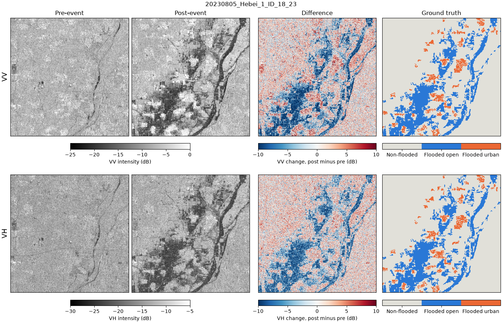
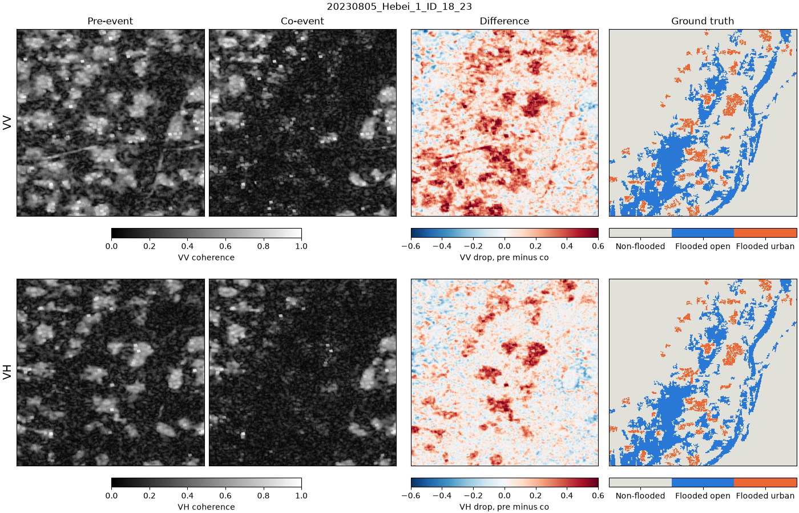

# UrbanSARFloods — Temporal Change & Foundation Models

Urban Computing | Group 15

## Project overview

We investigate urban flood segmentation using Sentinel-1 SAR imagery. We plan to compare a conventional U-Net and a pretrained SAR-capable foundation model, each with and without explicit temporal-change features. We will evaluate performance on held-out flood events.

## Setup

Use Python 3.11 or newer. The data loader was tested with Python 3.11.

```bash
python3 --version
python3 -m venv .venv
source .venv/bin/activate
python -m pip install -r requirements.txt
```

If `python3` points to a version older than 3.11, use the command for your newer installation, such as `python3.12`, when creating the environment.

## Dataset

Download `urban_sar_floods.tar.gz` from the [UrbanSARFloods release on Hugging Face](https://huggingface.co/datasets/S1Floodbenchmark/UrbanSARFloods_v1/blob/main/urban_sar_floods.tar.gz). This is the approximately 38 GB training and validation archive. See the [official dataset README](https://github.com/jie666-6/UrbanSARFloods) for the dataset description and separate test downloads.

Extract the archive so the project has this structure:

```text
data/
└── urban_sar_floods/
    ├── 01_NF/
    ├── 02_FO/
    ├── 03_FU/
    ├── Train_dataset.txt
    └── Valid_dataset.txt
```

Each class folder contains `SAR/` and `GT/` subfolders. Git ignores `data/`, so each collaborator needs a local copy of the dataset.

## Check the loader

Run this from the repository root to load one tile from each split:

```bash
python - <<'PY'
from dataset import UrbanSARFloods

for split in ("train", "val"):
    dataset = UrbanSARFloods("data/urban_sar_floods", split)
    image, mask = dataset[0]
    print(f"{split}: {len(dataset)} tiles")
    print(f"  Image: {image.shape}, {image.dtype}")
    print(f"  Mask:  {mask.shape}, {mask.dtype}")
PY
```

Each sample returns the original eight SAR bands as a `float32` array of shape `(8, 512, 512)` and an `int64` mask of shape `(512, 512)`. Mask labels are `0` for non-flooded, `1` for flooded open area, `2` for flooded urban area, and `255` for pixels without SAR data. The loader preserves the original SAR values for computing intensity differences before normalisation.

To inspect a specific image and mask, run `python inspect_tile.py path/to/tile_SAR.tif path/to/tile_GT.tif`.

## Missing pixels

```bash
python check_missing_pixels.py
```

| | Training | Validation |
| --- | ---: | ---: |
| Tiles | 4,501 | 1,970 |
| Tiles with missing pixels | 1,286 | 537 |
| Tiles without any valid pixel | 41 | 13 |
| Missing pixels | 15.6% | 14.0% |
| Flooded-urban pixels that are missing | 0 | 0 |
| Flooded-urban pixels in tiles with missing pixels | 29.2% | 25.5% |

A pixel is missing when any of its eight bands is NaN. The loader keeps these tiles instead of skipping them: the image keeps its NaN values, and the mask has the label `IGNORE_LABEL` (255) at those pixels, which is passed to the loss as `ignore_index`. Compute the difference maps first, then replace the remaining NaN values before the image enters the model. The 54 tiles without any valid pixel are listed in `empty_tiles.txt` and left out, so the loader returns 4,460 training and 1,957 validation tiles. Full output: [missing_pixels_check.log](results/dataset/missing_pixels_check.log).

## Band order

```bash
python check_band_order.py --tiles 1000
```

| Band | Content |
| ---: | --- |
| 1 | Pre-event coherence, VH |
| 2 | Pre-event coherence, VV |
| 3 | Co-event coherence, VH |
| 4 | Co-event coherence, VV |
| 5 | Pre-event intensity, VH (dB) |
| 6 | Pre-event intensity, VV (dB) |
| 7 | Post-event intensity, VH (dB) |
| 8 | Post-event intensity, VV (dB) |

The script averages each band per ground-truth class over the flooded-urban training tiles, ignoring NaN pixels. On all 471 of them:

- Bands 1–4 lie between 0 and 1 and bands 5–8 between −60 and 7, so the first four are coherence and the last four are intensity in dB.
- Bands 6 and 8 are about 6 dB brighter than bands 5 and 7, as expected for VV against VH.
- Over flooded open areas, bands 7 and 8 are about 7 dB darker than bands 5 and 6, so they are the post-event images.
- Over flooded urban areas, bands 1 and 2 are 0.30 and 0.35 higher than bands 3 and 4, and all but 19 of the 363,550 flooded-urban pixels exceed the paper's labelling threshold of 0.3 in at least one polarisation. Bands 1 and 2 are therefore the pre-event coherence.

The VH-before-VV order inside the two coherence pairs is assumed to match the intensity pairs. The statistics are consistent with that order but cannot prove it. The per-band means in the dataset's own `data_norm.txt` follow the same pattern. Full output: [band_order_check.log](results/temporal/band_order_check.log).

## Temporal-difference features

`add_intensity_differences` in `temporal_features.py` appends two maps to the eight original bands: post-event minus pre-event intensity for VV, then for VH. Both are computed on the original dB values, before normalisation, so each map is the log-ratio of the two intensities. The result has ten channels and keeps the original band order.

```python
from dataset import UrbanSARFloods
from temporal_features import add_intensity_differences

image, mask = UrbanSARFloods("data/urban_sar_floods", "train")[0]
image = add_intensity_differences(image)  # shape (10, 512, 512)
```

`add_coherence_differences` does the same for coherence: pre-event minus co-event for VV, then for VH, so a drop in coherence is positive. `add_all_differences` appends all four maps, which gives twelve channels. Missing pixels stay NaN in every map.

To plot the pre-event, post-event and difference images of one tile beside its mask (this needs matplotlib, which is in `requirements.txt`):

```bash
python plot_temporal_example.py data/urban_sar_floods/03_FU/SAR/20230805_Hebei_1_ID_18_23_SAR.tif data/urban_sar_floods/03_FU/GT/20230805_Hebei_1_ID_18_23_GT.tif
```



The example is a training tile without NaN pixels that contains both flood classes. Flooded open areas turn dark after the event and appear blue in the difference maps. The flooded urban areas become brighter in VV.

Add `--coherence` to plot the pre-event and co-event coherence and their difference instead:



On this tile the coherence drops by 0.43 (VV) and 0.35 (VH) over flooded urban areas, against 0.10 and 0.04 over non-flooded areas.

Mean change per class over the 471 flooded-urban training tiles, from `check_band_order.py`:

| Class | VV intensity | VH intensity | VV coherence drop | VH coherence drop |
| --- | ---: | ---: | ---: | ---: |
| Non-flooded | +0.98 dB | +0.84 dB | 0.11 | 0.09 |
| Flooded open | −7.33 dB | −6.92 dB | 0.21 | 0.15 |
| Flooded urban | +1.70 dB | +0.70 dB | 0.35 | 0.30 |

Intensity change is post-event minus pre-event, and coherence drop is pre-event minus co-event. The intensity differences separate flooded open areas clearly. Within these tiles, flooded urban pixels differ from non-flooded pixels by less than 1 dB on average, while their coherence drop is about three times larger. This matches how the paper made the labels: flooded open areas from intensity change detection, and flooded urban areas from a coherence drop above 0.3 in built-up areas.

## U-Net smoke test

`smoke_unet.py` checks that U-Net can load a real training tile and its mask, compute a loss, and update its weights. Each run repeats training on one eight-channel, 256 × 256 center crop.

### LIACS environment

The GPU tests used Python 3.11.3, PyTorch 2.1.2, TorchVision 0.16.0, NumPy 1.25.1, Rasterio 1.4.4, and `segmentation-models-pytorch` 0.6.0. The LIACS environment used `affine==2.4.0` to resolve a compatibility error during the image–mask alignment check.

### Run the test

From the repository root in the LIACS CUDA environment:

```bash
python smoke_unet.py --device cuda --steps 10
```

The command uses the first tile listed in `data/urban_sar_floods/Train_dataset.txt`. Use `--index` to select another tile from the manifest.

Add `--differences` to train on the ten-channel input that includes the two intensity-difference maps:

```bash
python smoke_unet.py --device cuda --steps 10 --differences
```

Use `--differences coherence` for the two coherence-difference maps instead, or `--differences both` for all four maps (twelve channels). Pixels without SAR data are left out of the loss.

For the urban-flood run, we used a separate local folder containing one SAR tile, its matching mask, and a one-line `Train_dataset.txt`. With that folder set up, run:

```bash
python smoke_unet.py --data-root data/smoke_flooded --device cuda --steps 10
```

### LIACS results

Both runs used an NVIDIA GeForce RTX 4060 and completed all 10 training steps.

| Training crop | Urban-flood pixels | Loss, step 1 → 10 | Mean step time | Peak allocated CUDA memory |
| --- | ---: | ---: | ---: | ---: |
| Non-flooded | 0 | 0.9428 → 0.2489 | 12 ms | 283 MiB |
| Contains urban flooding | 396 | 0.9430 → 0.2516 | 12 ms | 283 MiB |

The mean step time excludes the first three warm-up steps and measures training with the crop already on the GPU. The loss is calculated across the whole crop. Evaluating urban-flood detection will require class-specific metrics on held-out data.

- [Non-flooded crop log](results/smoke/unet_256_10steps.log)
- [Urban-flood crop log](results/smoke/unet_flooded_256_10steps.log)

## Team

- Beyza Celep
- Elena Martellucci